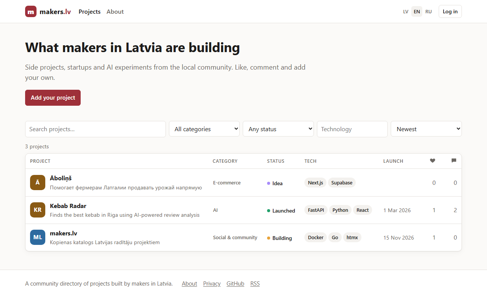

# makers.lv

[](https://github.com/aleksejs1/makers/actions/workflows/ci.yml)
[](LICENSE)

A community directory of projects built by makers in Latvia — side projects,
startups and AI experiments. Anyone can browse; members log in with a one-time
email code, add their projects, like and comment.

**Live:** <https://makers.lv> · Interface in 🇱🇻 Latvian, 🇬🇧 English and 🇷🇺 Russian.



## Features

- Project table with search, filters (category, status, technology) and sorting
- Project pages: pitch, Markdown description, links, embedded YouTube / Vimeo / Loom video,
  tech stack, AI tools used, status, launch date, "looking for" and more
- Passwordless login with 8-digit email codes bound to the requesting browser (no passwords stored, ever)
- Likes and comments, public user profiles (`/u/<username>`)
- Moderation: hide projects and comments, ban users
- Three interface languages with language-prefixed URLs, browser language detection and `hreflang`
- SEO basics: server-side rendering, Open Graph tags, `sitemap.xml`, RSS feed
- Privacy-friendly: no trackers, no third-party requests except embedded videos
- A single ~17 MB Docker image with an SQLite database on a volume

## Tech stack

| | |
|---|---|
| Backend | Go (standard library `net/http`), no web framework |
| Database | SQLite via [`modernc.org/sqlite`](https://pkg.go.dev/modernc.org/sqlite) (pure Go, no CGO), FTS5 search |
| Frontend | Server-rendered `html/template` + [htmx](https://htmx.org), one CSS file, no build step |
| i18n | [`go-i18n`](https://github.com/nicksnyder/go-i18n) with TOML files and CLDR plural rules |
| Packaging | Multi-stage Dockerfile, `FROM scratch` runtime image, multi-arch (amd64/arm64) |

Templates, static files, translations and migrations are embedded into the binary.

## Quick start

### Docker

```bash
docker run -d --name makers \
  -p 8080:8080 \
  -e MAKERS_BASE_URL=http://localhost:8080 \
  -e MAKERS_ENV=dev \
  -v makers-data:/data \
  ghcr.io/aleksejs1/makers:latest
```

Open <http://localhost:8080>. Without SMTP settings, login codes are printed to the
container log (`docker logs makers`).

### From source

Requires Go 1.26+.

```bash
make run          # or: MAKERS_ENV=dev go run ./cmd/makers
```

### Development with hot reload

```bash
make dev          # docker compose -f compose.dev.yaml up --build
```

This starts the app with [air](https://github.com/air-verse/air) at <http://localhost:8080>
and [Mailpit](https://mailpit.axllent.org) at <http://localhost:8025>, where login emails arrive.
Log in as `admin@makers.lv` to get moderator rights.

## Configuration

All settings are environment variables (each also has a command-line flag, see `makers serve -h`).

| Variable | Default | Description |
|---|---|---|
| `MAKERS_PORT` | `8080` | Port to listen on. Point your reverse proxy here. |
| `MAKERS_BASE_URL` | `http://localhost:$PORT` | Public URL. `https://` enables secure cookies. |
| `MAKERS_DB_PATH` | `makers.db` (`/data/makers.db` in Docker) | SQLite database file. |
| `MAKERS_SECRET` | random per start | Key for hashing login codes. Set it in production (≥ 16 chars, e.g. `openssl rand -hex 32`). |
| `MAKERS_ADMIN_EMAILS` | — | Comma-separated emails of moderators. |
| `MAKERS_TRUSTED_PROXIES` | — | Comma-separated IPs/CIDRs of your reverse proxies, e.g. `172.16.0.0/12` for Docker networks. Only requests from these addresses may set the client IP via `X-Forwarded-For`; the proxy must append to that header (Caddy does by default; nginx needs `proxy_set_header X-Forwarded-For $proxy_add_x_forwarded_for;`). |
| `MAKERS_ENV` | `prod` | `dev` switches to human-readable logs and allows running without SMTP. |
| `SMTP_HOST` | — | SMTP server. **Required in production**; with `MAKERS_ENV=dev` and no host, emails are written to the log. |
| `SMTP_PORT` | `587` | SMTP port. |
| `SMTP_TLS` | `tls` for port 465, else `starttls` | `starttls` refuses to send if the server doesn't offer it. `none` sends unencrypted — only for local mail catchers like Mailpit. |
| `SMTP_USER`, `SMTP_PASSWORD` | — | SMTP credentials. |
| `SMTP_FROM` | `makers.lv <noreply@makers.lv>` | Sender address. |

## Deployment

1. Copy [`.env.example`](.env.example) to `.env` and fill it in.
2. `docker compose up -d` (see [`compose.yaml`](compose.yaml)) — the app listens on `127.0.0.1:$MAKERS_PORT`.
3. Put a TLS-terminating reverse proxy in front of it, e.g. Caddy:

   ```caddy
   makers.lv {
       reverse_proxy 127.0.0.1:8080
   }
   ```

The image runs as a non-root user, has a built-in health check (`makers healthcheck`)
and shuts down gracefully on `SIGTERM`.

### Backups

The whole state is one SQLite file in the `/data` volume. Take a consistent copy while running:

```bash
docker exec makers /makers backup /data/backup-$(date +%F).db
```

For continuous replication to S3-compatible storage, [Litestream](https://litestream.io) works well with this setup.

## Project layout

```
cmd/makers/          entry point: serve, healthcheck, backup, version
internal/
  auth/              login codes, session tokens
  config/            environment and flags
  db/                SQLite connection and embedded migrations
  i18n/              translations and language detection
  mail/              SMTP sender
  markdown/          Markdown rendering and sanitizing
  server/            HTTP handlers, middleware, views, tests
  slug/              slugs and usernames
  store/             data access
  video/             YouTube / Vimeo / Loom embeds
ui/
  templates/         layout, pages and htmx partials
  static/            CSS, JS, icons
  locales/           en.toml, lv.toml, ru.toml
```

## Contributing

Contributions are welcome — code, translations, design and ideas. Please read
[CONTRIBUTING.md](CONTRIBUTING.md) and our [Code of Conduct](CODE_OF_CONDUCT.md).
To report a security issue, see [SECURITY.md](SECURITY.md).

## License

[MIT](LICENSE). htmx is distributed under the Zero-Clause BSD license.
